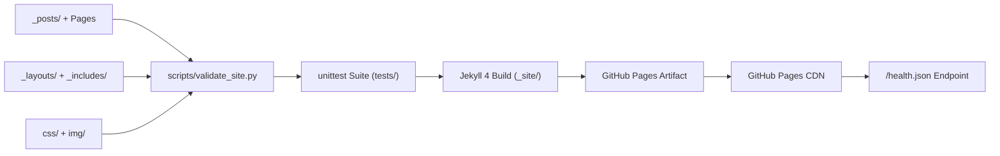

# Architecture & Service Flow

`itselavia.github.io` (**Agentic**) is a static engineering blog built with Jekyll 4 and deployed to GitHub Pages.

## Build & Deployment Pipeline

## Component Boundaries

| Component | Path | Responsibility |
| --- | --- | --- |
| Site Configuration | `_config.yml` | Site metadata, pagination (`jekyll-paginate`), RSS feed (`jekyll-feed`), and build exclusions |
| Layouts & Partials | `_layouts/`, `_includes/` | HTML5 structure, responsive navigation, social footer, head metadata |
| Content | `_posts/`, `index.html`, `about.html` | Markdown articles and top-level pages |
| Styling | `css/style.css`, `css/syntax.css` | CSS custom properties, responsive grid, typography, Rouge code highlighting |
| Health Probe | `health.json` | Static JSON health and build metadata endpoint served at `/health.json` |
| Validation & QA | `scripts/`, `tests/` | Static analyzer, formatter, doc generator, structured logger, and test suite |

## External Services & Dependencies

1. **GitHub Pages CDN (`https://itselavia.github.io`)**: Hosts the built `_site/` artifact deployed by `.github/workflows/deploy.yml`.
2. **Google Fonts (`https://fonts.googleapis.com`, `https://fonts.gstatic.com`)**: Serves `Lora` and `Open Sans` web fonts referenced in `_includes/head.html`.
3. **SonarQube Cloud (`https://sonarcloud.io/dashboard?id=itselavia_itselavia.github.io`)**: Runs automatic static analysis and Quality Gate checks on commits and pull requests.
4. **Google Analytics (Optional, Disabled by Default)**: `_includes/ga.html` only renders when `google_tracking_id` is set in `_config.yml`.
